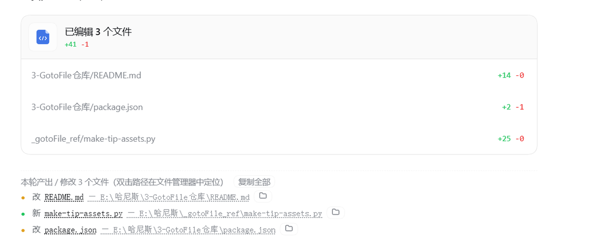

# dsh-GotoFile

> 对话结尾列出本轮**产出 / 修改**的文件，**双击路径**直接在资源管理器里定位。
> A DSH plugin that prints the files a turn produced or changed — **double-click a path to reveal it in your OS file manager.**

DSH 的官方「改动文件」卡片只活在浏览器里：要离开 GUI 读一份清单、要整段复制路径、要在资源管理器里打开文件，都得再手动翻一遍。这个插件把同一份「本轮改动」数据渲染成**纯文本行**放进对话结尾，并让每一行路径都能双击落到系统文件管理器。

```
本轮产出 / 修改 3 个文件（双击路径在文件管理器中定位）        [复制全部]
● 新  report.md      — E:\哈尼斯\项目\docs\report.md              📂
● 改  index.js       — E:\哈尼斯\项目\src\index.js                 📂
● 改  old-config.yml — E:\哈尼斯\项目\old-config.yml （已不存在）
```

真实运行效果（结尾的文本块：「已编辑 3 个文件」卡片是 DSH 自带的，下面一行才是本插件）：



## 特性

- **文本，不是卡片**：整段可选中、可复制（右上角「复制全部」一键拷走全部绝对路径），粘贴到哪里都好用。
- **双击即定位**：双击路径文本 → Windows 资源管理器 / macOS Finder / Linux 文件管理器打开并**选中**该文件（`explorer /select,`、`open -R`、`xdg-open`）。
- **正文里的路径也能双击**：`` `src/index.js` `` 这种裸路径、或手动选中的一段路径，双击同样生效——不用回到报告里找。
- **只记真的写成功的**：登记 `write` / `edit` / `str_replace_editor` / `ops_replace` 的**成功**调用，失败的、只读的调用一律不出现。
- **新 / 改 有区分**：本轮首次写入该路径 = **新**；改动一个已存在的文件 = **改**。
- **失效文件自动置灰**：文件被外部删掉的行显示「（已不存在）」并禁用双击。
- **零依赖、无构建**：两个源文件（宿主半 + 浏览器半），`node --test` 直接跑单测。
- **默认就安全**：所有路由校验本机同源（防本地 CSRF）；只有会话工作目录 / 家目录 / 用户显式声明的白名单根里的路径才能被系统打开。

## 安装

放进 **profile 的 `node_modules`**，然后在同一个 profile 的 `cordis.patch.yml` 末尾登记：

```yaml
- insert:
    - id: goto-file
      name: dsh-GotoFile
```

典型位置：

```
<profile>/node_modules/dsh-GotoFile/
<profile>/cordis.patch.yml
```

改完 `cordis.patch.yml` 需要**重启桌面端**（或重新加载 profile）才会挂载。挂载成功可以在插件管理里看到 `goto-file` / `dsh-GotoFile` / 状态 `active`。

## 配置：外置盘 / 网络盘白名单

`设置 → GotoFile`，每行一个根目录（支持 `~/`），**保存立即生效**，不用重启、不用改 YAML。

- 默认留空 = 只放行**家目录**与**会话工作目录**内的路径；其他位置的路径双击会被拒绝，报告里仍会列出但打开请求返回 404。
- 系统盘特征目录（`C:\` 之类，即根下存在 `Windows` / `System` / `etc`）会被自动拒绝，避免一条白名单把整台机器敞开口。
- 白名单根还会做 `realpath` 逃逸检查（symlink 不能溜出根）。

## 工作原理（一图）

```
一轮对话
  │ 工具调用 write / edit / str_replace_editor / ops_replace
  ▼
宿主半 lib/index.js
  ctx.on('session/event')
    tool/call   ──► pending.set(callId, {turn, 路径, 是否新建})
    tool/result ──► 只有成功（isError !== true）才计入登记簿
                     ├ op = 新建且首次收录 ? 'new' : 'edit'
                     └ 子代理会话（origin==='subagent'）不参与
  (可选补漏) ctx.get('workspaceChanges').summary(...) → 官方含 git 快照的权威清单
  POST /api/goto-file/check  → 本轮文件清单
  POST /api/goto-file/open   → 系统打开 / 定位（同源校验 + 路径安全口径）
  ▼
浏览器半 lib/client.js
  turnTail 槽：渲染纯文本行，双击判 event.detail === 2 → /open reveal
  正文双击委托：document dblclick 抓裸 <code> / 选中文本 → /open reveal
```

源码级查证过的坑（八条，含 `explorer.exe` 把 `/` 当开关、turnTail 槽在 0.1.7 前后的双模签名、`webServer` 必须动态注入等）都记在 [docs/architecture.md](docs/architecture.md)。

## 源码结构

| 文件 | 作用 |
| --- | --- |
| `lib/index.js` | 宿主半：本轮改动登记簿 + 三条 API 路由 + 路径安全判定 + 系统打开 |
| `lib/client.js` | 浏览器半：turn-tail 文本报告、双击委托、设置卡片 |
| `test/host.test.js` | 宿主半纯逻辑单测（18 例，`node --test`） |
| `docs/architecture.md` | 架构、数据流与关键决策 |
| `cordis.patch.yml` | 供参考的挂载补丁片段 |

## 开发

```bash
node --test        # 18 个单测，零依赖、无需 npm install
```

宿主半对 `@deepseek-ai/schemastery` 的依赖是**懒加载**的（挂载时才解析真包，解析不到就退回恒等形态），
所以这个仓库可以被单独克隆出来直接跑测试，不必放在 DSH profile 里。

## 已知边界

- 外部命令产生的文件（`> out.txt`、`git checkout` 等）不在登记簿里，只能靠官方 `workspaceChanges` 的 git 快照补漏；**非 git 目录下这类改动不会出现**。
- 单轮文件数上限 `maxFilesPerTurn`（默认 200），防止病态轮次撑爆登记簿。
- 双击是浏览器手势，纯键盘用户可按 Enter（行有 `tabIndex`）触发定位。

## License

MIT

---

## 打赏

本项目为个人爱好驱动的开源插件，如果帮助到了您，欢迎各位大老板顺手请我喝杯咖啡，非常感谢打赏！

<table>
  <tr>
    <td align="center"><b>微信</b><br></td>
    <td align="center"><b>支付宝</b><br></td>
  </tr>
</table>

