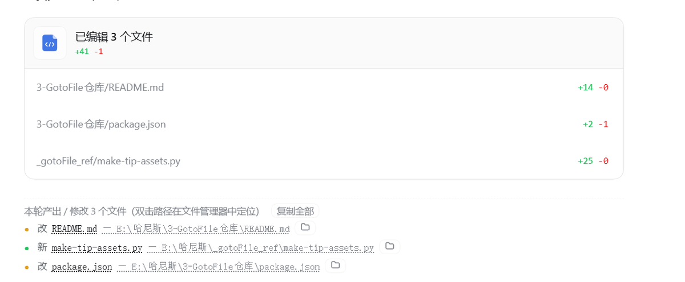

# dsh-GotoFile

> 对话结尾列出本轮**产出 / 修改**的文件，**双击路径**直接在资源管理器里定位。
> A DSH plugin that prints the files a turn produced or changed — **double-click a path to reveal it in your OS file manager.**

DSH 的官方「改动文件」卡片只活在浏览器里：要离开 GUI 读一份清单、要整段复制路径、要在资源管理器里打开文件，都得再手动翻一遍。这个插件把同一份「本轮改动」数据渲染成**纯文本行**放进对话结尾，并让每一行路径都能双击落到系统文件管理器。

```
本轮产出 / 修改 3 个文件（双击路径在文件管理器中定位）        [复制全部]
● 新  report.md      — E:\workspace\project\docs\report.md          📂
● 改  index.js       — E:\workspace\project\src\index.js            📂
● 改  old-config.yml — E:\workspace\project\old-config.yml （已不存在）
```

真实运行效果（结尾的文本块：「已编辑 3 个文件」卡片是 DSH 自带的，下面一行才是本插件）：



## 特性

- **文本，不是卡片**：整段可选中、可复制（右上角「复制全部」一键拷走全部绝对路径），粘贴到哪里都好用。
- **双击即定位**：双击路径文本 → Windows 资源管理器（`explorer /select,`）与 macOS Finder（`open -R`）会打开并**选中**该文件；Linux 没有统一的「在文件管理器中选中」接口，`xdg-open` 只能**打开文件本身**（目录则打开该目录）。
- **↗ 用默认程序打开**：每行还有一颗 ↗，交给系统默认程序——HTML 产物直接进浏览器，不用先去资源管理器再双击。
- **写完就算，不管用哪条通道写**：`write` / `edit` / `ops_write_file` / `str_replace_editor` / `ops_replace`、PTC 的 `run_code` 脚本（含 `const p = "…"` 后再写 `p`、`WB + "/web/index.html"` 拼接、`fs.writeFileSync`、python `open(...,'w')`）、`pwsh` / `ops_bash` / `win_bash` 的重定向与 `Set-Content` / `tee` / `cp`、以及 `present` 的交付清单。回放这台机器 192 个真实会话：识别到的路径从 5186 条升到 9180 条，其中 `.html` 从 163 条升到 495 条。
- **子代理写的也算本轮**：委派出去的会话里写出的文件，挂到父会话当前轮，不再因为 `origin=subagent` 被整批丢弃。
- **正文里的路径也能双击**：`` `src/index.js` `` 这种裸路径、或手动选中的一段路径，双击同样生效——不用回到报告里找。
- **只记真的写成功的**：登记成功调用；失败的、只读的调用一律不出现。
- **新 / 改 有区分**：本轮首次写入该路径 = **新**；改动一个已存在的文件 = **改**。
- **失效文件自动置灰**：文件被外部删掉的行显示「（已不存在）」并禁用双击；超出允许范围的行标「（不在白名单）」。
- **跨盘产物不再被白名单卡住**：本会话亲眼看到写成功的路径直接放行——工作区在 `C:`、产物落 `E:` 也能双击。只有「报告里有、但不是本会话写的」路径才需要白名单。
- **零依赖、无构建**：两个源文件（宿主半 + 浏览器半），`node --test` 直接跑单测。
- **默认就安全**：所有路由先过本机同源校验（Origin 的端口必须与请求 Host 的端口一致，本地别的开发端口一律拒绝），请求体只收 `application/json`；家目录里的凭据类目录（`AppData` / `.ssh` / `.npmrc` …）默认拒绝。


## 安装

已发布到 npm：**<https://www.npmjs.com/package/dsh-gotofile>**（包名只能小写，仓库与插件显示名仍写作 *dsh-GotoFile*）。

**方式一：官方 CLI（推荐）**

```bash
# 先退出桌面端客户端：desktop profile 在桌面端运行时被独占，plugin 命令会被拒绝
dsh plugin --profile desktop add dsh-gotofile
```

**方式二：手动装进 profile**

```bash
cd "$DSH_HOME/profiles/desktop"     # Windows 下类似 E:\...\2-DSH运行数据\profiles\desktop
pnpm add dsh-gotofile               # 或 npm i dsh-gotofile
```

装完 `package.json` 里应该有 `"dsh-gotofile": "^1.0.4"`（`dependencies`）与 `dsh.profile.bundles` 里的一项 —— 后者是它出现在**插件管理**列表里的前提（只把目录塞进 `node_modules` 而不写依赖，宿主侧能挂载，但插件管理里看不到它）。

然后在同一个 profile 的 `cordis.patch.yml` 末尾登记（DSH 的插件市场/插件管理安装时也会自动写入这一行）：

```yaml
- insert:
    - id: goto-file
      name: dsh-gotofile
```

手动安装也行——把整包放进 profile 的 `node_modules`：

```
<profile>/node_modules/dsh-gotofile/
<profile>/cordis.patch.yml
```

改完 `cordis.patch.yml` 需要**重启桌面端**（或重新加载 profile）才会挂载。挂载成功可以在插件管理里看到 `goto-file` / `dsh-gotofile` / 状态 `active`。

## 配置：外置盘 / 网络盘白名单

`设置 → GotoFile`，每行一个根目录（支持 `~/` 与 `~\`），**保存立即生效**，不用重启、不用改 YAML。

- 默认留空 = 只放行**会话工作目录**与**家目录**内的路径；其他位置的路径双击会被拒绝，报告里仍会列出但打开请求返回 404。
- 盘根可以直接填：`D:\`、`F:\` 都行（也接受只写 `D:`，会补成盘根；带不带尾斜杠、盘符大小写都不影响）。
- 家目录里有一批**凭据类目录默认不放行**（`AppData`、`Library`、`.ssh`、`.aws`、`.gnupg`、`.kube`、`.docker`、`.npmrc`、`.netrc`、`.git-credentials`）——这些位置的文件一旦被系统默认程序打开，等于把本机账号交出去。确实需要时把它们写进白名单即可（写进去 = 显式授权）。
- 系统盘特征目录（`C:\` 之类，即根下存在 `Windows` / `System` / `etc`）会被自动拒绝，避免一条白名单把整台机器敞开口。
- 白名单根还会做 `realpath` 逃逸检查（symlink 不能溜出根）。

## 权限：它会碰什么

- **会话**：只监听 `session/event` 里的 `tool/call` / `tool/result`（工具名与路径参数，配对成功才记账）与 `workspace/changes`（只取轮次号和事件序号）；不读对话正文，不改会话数据，不落盘。
- **文件**：只对报告里的路径做存在性检查（`existsSync` / `statSync`）；「打开」交给系统文件管理器（Windows `explorer`、macOS `open -R`、Linux `xdg-open`），经 `execFile` 直传参数、不经 shell，不会执行文件内容。
- **路径范围**：本会话亲手写过并登记成功的路径（跨盘直接放行）、会话工作目录、家目录（`AppData` / `.ssh` / `.npmrc` 等凭据类目录默认拒绝）、你显式声明的白名单根。
- **网络**：**不联网**。没有遥测、没有外部请求；三条路由只服务本机，且校验同源与端口。

*What it touches: session tool events (names + path arguments only, message text is not read), file existence checks, the OS file manager for reveal/open, and no network at all.*

## 工作原理（一图）

```
一轮对话
  │ 写类调用：write / edit / ops_write_file / str_replace_editor / ops_replace
  │          run_code 脚本（tools.write|edit|present、fs.*、python open）
  │          pwsh / ops_bash / win_bash（> >> Set-Content tee cp）
  │          present（交付清单）
  ▼
宿主半 lib/index.js
  ctx.on('session/event')
    tool/call   ──► pending.set(callId, {turn, 路径, 是否新建, 调用前是否存在})
    tool/result ──► 只有成功（isError !== true）才计入登记簿
                     ├ op = 新建且首次收录 ? 'new' : 'edit'
                     └ 一层子代理（origin=subagent）的写入挂到父会话当前轮
  workspace/changes ──► 记下 turn → seq
  (补漏) ctx.workspaceChanges.summary(sessionId, seq) → 官方含 git 快照的权威清单
  POST /api/goto-file/check  → 本轮文件清单（含 exists / probeable）
  POST /api/goto-file/open   → 系统打开 / 定位（同源校验 + 路径安全口径）
  ▼
浏览器半 lib/client.js
  turnTail 槽：恒挂载，向 /check 取权威清单；空清单自己返回 null
              每行 = ● 新/改 文件名 — 绝对路径 [📂 定位] [↗ 默认程序打开]
  正文双击委托：document dblclick 抓裸 <code> / 选中文本 → /open reveal
```

源码级查证过的坑（含 `explorer.exe` 把 `/` 当开关、turnTail 槽在 0.1.7 前后的双模签名、
`webServer` 必须动态注入、`workspaceChanges.summary` 认 seq 不认轮次号等）都记在
[docs/architecture.md](docs/architecture.md)。

## 源码结构

| 文件 | 作用 |
| --- | --- |
| `lib/index.js` | 宿主半：本轮改动登记簿 + 三条 API 路由 + 路径安全判定 + 系统打开 |
| `lib/client.js` | 浏览器半：turn-tail 文本报告、双击委托、设置卡片 |
| `test/` | 单测：`host.test.js`（宿主半纯逻辑）+ `apply.test.js`（假 ctx 挂载冒烟）+ `manifest.test.js`（包清单一致性），共 50 例，`node --test` |
| `docs/architecture.md` | 架构、数据流与关键决策 |
| `cordis.patch.yml` | 供参考的挂载补丁片段 |

## 开发

```bash
node --test        # 50 个单测，零依赖、无需 npm install
```

宿主半对 `@deepseek-ai/schemastery` 的依赖是**懒加载**的（挂载时才解析真包，解析不到就退回恒等形态），
所以这个仓库可以被单独克隆出来直接跑测试，不必放在 DSH profile 里。

## 已知边界

- **命令里的变量目标猜不出来**：`Set-Content -Path $p`、`> %TEMP%\x.html` 这类目标无法静态求值，一律跳过（宁可漏报不猜）。同一条命令里如果有字面量目标（`> out.html`），照常登记。
- **只挂一层子代理**：`delegationDepth = 1` 的子会话归到父会话当前轮；更深层（子代理再派子代理）不归并，避免轮次错位。
- **重启后历史轮次没有报告**：登记簿是内存里的，DSH 重启后旧轮次只剩官方 `workspaceChanges` 快照（它重启后也没有），所以历史轮要重新产出才有。
- 外部进程（另一个终端、编辑器、`git checkout`）改动的文件不在登记簿里，只能靠官方快照补漏；**非 git 目录下这类改动不会出现**。
- `ops_replace` 的 `glob` 参数是**模式**不是路径（`src/*.ts`、`**/*.js`），不会被展开成具体文件；那一轮登记的是它的 `path` 参数。
- 单轮文件数上限 `maxFilesPerTurn`（默认 200），防止病态轮次撑爆登记簿。
- **Linux 上双击是「打开」不是「定位选中」**：`xdg-open` 没有选中参数，双击会用默认程序打开该文件（目录则打开目录）。Windows / macOS 才是资源管理器 / Finder 里定位选中。
- 双击是浏览器手势，纯键盘用户可按 Enter（行有 `tabIndex`）触发定位。

## License

MIT

---

## 打赏

本项目为个人爱好驱动的开源插件，如果帮助到了您，欢迎各位大老板顺手请我喝杯咖啡，非常感谢打赏！

<table>
  <tr>
    <td align="center"><b>微信</b><br></td>
    <td align="center"><b>支付宝</b><br></td>
  </tr>
</table>

